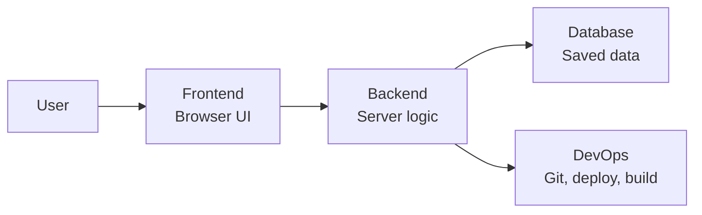

Module 1: Introduction to Full Stack Development | Lesson 1 of 5 | 15 minutes | Prerequisites: [00-setup](../../00-setup/README.md)

## Big idea

A full stack developer understands the whole web app, not just one part. The browser, the server, the database, and the deployment setup each do different jobs, and they must work together.

## Concepts

A web app usually has four main layers:

- Frontend: the part a user sees and interacts with. Examples: buttons, forms, menus, pages.
- Backend: the logic that runs on a server. It checks rules, talks to the database, and decides what to send back.
- Database: the place where data is stored for later. Examples: user records, task lists, product data.
- DevOps: the tools and setup that help the app run reliably. Examples: Git, Docker, deployment scripts.

Real-world analogy: think of a restaurant. The frontend is the dining room where customers see and click. The backend is the kitchen where cooks follow recipes and prepare food. The database is the pantry and fridge where ingredients are stored. DevOps is the system that keeps the restaurant open, stocked, and delivered on time.

### SDLC

SDLC means Software Development Life Cycle. It is the path a project follows from idea to production.

1. Plan: decide what the app should do.
2. Design: decide the screens and data structure.
3. Develop: write the code.
4. Test: check whether it works.
5. Deploy: put it online.
6. Maintain: fix bugs and add features.

### Frontend vs backend

| Area | Frontend | Backend |
|---|---|---|
| Runs on | Browser | Server |
| User sees it? | Yes | No |
| Typical jobs | Layout, buttons, visual design | Business rules, data logic, security |
| Example tools | HTML, CSS, JavaScript, React | Node.js, Express, databases |

## Diagram



## Code

```js
// 1. A tiny app has a user-facing layer and a server layer.
const frontend = 'Browser page';
const backend = 'Server logic';
const database = 'Saved data';

// 2. We do not mix all jobs into one file because each layer has a different job.
console.log('Frontend shows UI:', frontend);
console.log('Backend handles rules:', backend);
console.log('Database keeps data:', database);
```

## Try it

- Open a browser and look at a site you use every day.
- Notice the menu, text, and buttons. That is the frontend.
- Imagine the server logic behind it: login checks, saving tasks, and data validation.
- Write down one thing that belongs to each layer.

## Check yourself

1. What is the frontend?  
   <details>
   <summary>Answer</summary>
   The frontend is the interface the user sees and interacts with in the browser.
   </details>

2. What is the backend?  
   <details>
   <summary>Answer</summary>
   The backend runs on a server and handles logic, database access, and security.
   </details>

3. Why do we separate layers?  
   <details>
   <summary>Answer</summary>
   Each layer has a different job. This makes the app easier to build, test, and change.
   </details>

## Common mistakes

- Thinking the whole app is just HTML and CSS.
- Confusing the database with the server. The database stores data. The server reads and writes it.
- Forgetting that deployment and Git are part of building software, not just code writing.

## Next lesson

[Lesson 2: Internet and HTTP](02-internet-and-http.md)

<details>
<summary>Instructor notes</summary>

Talking points:

- Keep the restaurant analogy simple. Students remember it.
- Explain that frontend and backend are not separate people or teams only; they are layers in the same app.
- Show a real app like a to-do list and point to where each layer lives.

Live demo steps:

1. Open a simple app in the browser.
2. Open DevTools.
3. Point to the page and say, “This is the frontend.”
4. Explain that the server sends the data behind it.
5. Show one database-like JSON array in a mock API response.

</details>
