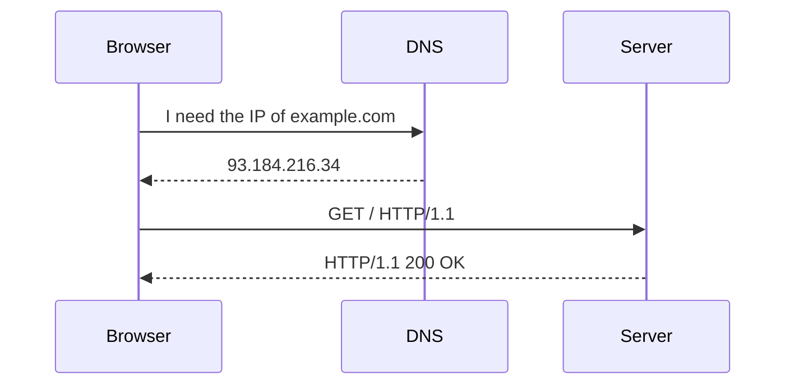

Module 1: Introduction to Full Stack Development | Lesson 2 of 5 | 20 minutes | Prerequisites: [Lesson 1](01-what-is-full-stack.md)

## Big idea

The internet is a huge network of computers that talk to each other. Browsers and servers use rules called HTTP and HTTPS to send requests and responses.

## Concepts

The internet is made of connected devices. Each device has an IP address, which is a unique number used to identify it on the network. DNS is a service that turns website names like `google.com` into IP addresses so computers can find each other.

A URL is the full address of a resource online.

```text
https://example.com:443/tasks?id=1#top
|      |          |    |      |     |
protocol host      port path  query fragment
```

- Protocol: the rule set used to talk.
- Host: the server name.
- Port: a door number for a service on that machine.
- Path: the specific resource like `/tasks`.
- Query: extra data like `?id=1`.
- Fragment: a page section like `#top`.

HTTP stands for HyperText Transfer Protocol. HTTPS adds encryption so the data is harder to intercept or change. In production, HTTPS is the default.

HTTP methods tell the server what action to take.

| Method | Meaning | Example |
|---|---|---|
| GET | Read data | Load a task list |
| POST | Create data | Add a new task |
| PUT/PATCH | Update data | Rename a task |
| DELETE | Remove data | Delete a task |

Status codes tell you the result of a request.

| Code | Meaning |
|---|---|
| 200 | OK |
| 201 | Created |
| 400 | Bad request |
| 401 | Not logged in |
| 403 | Forbidden |
| 404 | Not found |
| 500 | Server error |

Real-world analogy: imagine a post office. The internet is the road network. The IP address is the house number. DNS is the address book. The URL is the full mailing address. HTTP is the shipping rulebook. The status code is the response note from the post office.

## Diagram



## Code

```js
// 1. A URL has a protocol, host, and path.
const url = 'https://api.example.com:443/tasks?status=done';

// 2. We can read the pieces with the built-in URL class.
const parsed = new URL(url);

console.log('protocol:', parsed.protocol);
console.log('host:', parsed.host);
console.log('pathname:', parsed.pathname);
console.log('search:', parsed.search);
```

## Try it

- Open a terminal.
- Run `node -p "new URL('https://example.com/tasks?id=1').host"`.
- Run the same for `protocol` and `pathname`.
- Then open a browser and inspect a request in DevTools.

## Check yourself

1. What does DNS do?  
   <details>
   <summary>Answer</summary>
   DNS turns a domain name like `example.com` into an IP address.
   </details>

2. What is the difference between HTTP and HTTPS?  
   <details>
   <summary>Answer</summary>
   HTTPS adds encryption. HTTP does not.
   </details>

3. Why do we use status codes?  
   <details>
   <summary>Answer</summary>
   Status codes tell both humans and programs whether a request succeeded, failed, or needs attention.
   </details>

## Common mistakes

- Thinking a domain name is the same as an IP address.
- Forgetting that HTTPS is a secure version of HTTP.
- Treating a URL like a file path only. It also includes protocol, host, and query parameters.

## Next lesson

[Lesson 3: Client-Server Request Response](03-client-server-request-response.md)

<details>
<summary>Instructor notes</summary>

Talking points:

- Explain that DNS is like a phone book for the internet.
- Show `curl -I https://example.com` to see status headers.
- Use the URL anatomy diagram to make the parts easy to remember.

Live demo steps:

1. Open a browser and go to a public website.
2. Open DevTools > Network.
3. Click the main document request.
4. Point to the status code and the URL.
5. Explain that the server response is telling us whether the page was found and delivered.

</details>
