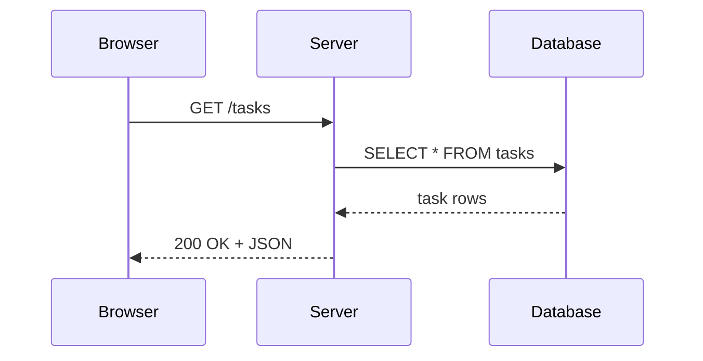

Module 1: Introduction to Full Stack Development | Lesson 3 of 5 | 20 minutes | Prerequisites: [Lesson 2](02-internet-and-http.md)

## Big idea

The client-server model explains how a browser asks for data and a server sends it back. Most web apps work in this request-response cycle.

## Concepts

A client is the program that starts the request. In web apps, the client is usually a browser. A server is a computer program waiting for requests and sending back a response.

The browser sends a request when you open a page or click a button. The server checks the request, may read or write data, and returns a response. The browser then renders the response on screen.

A request contains method, path, headers, and sometimes a body. A response contains status code, headers, and a body. The body may be HTML, JSON, CSS, or image data.

Real-world analogy: think of a restaurant order. The customer is the client. The waiter is the network layer. The kitchen is the server. The cooked food is the response.

## Diagram



## Code

```js
// 1. A browser sends a request to a server.
const request = {
  method: 'GET',
  url: '/tasks',
  headers: {
    accept: 'application/json'
  }
};

// 2. The server responds with JSON and a status code.
const response = {
  statusCode: 200,
  headers: {
    'content-type': 'application/json'
  },
  body: JSON.stringify([{ id: 1, title: 'Learn HTTP' }])
};

console.log('Request:', request.method, request.url);
console.log('Response status:', response.statusCode);
console.log('Body:', response.body);
```

## Try it

- Open any site in a browser.
- Press `Command + Option + I` on Mac or `F12` on Windows.
- Open the Network tab.
- Refresh the page.
- Click one request and inspect the method, status code, headers, and response preview.

## Check yourself

1. What is the client in a web app?  
   <details>
   <summary>Answer</summary>
   The client is usually the browser, which sends requests to a server.
   </details>

2. What does a server do?  
   <details>
   <summary>Answer</summary>
   The server handles requests, may access a database, and sends back a response.
   </details>

3. Why do browsers open the Network tab?  
   <details>
   <summary>Answer</summary>
   It helps you inspect what requests the app made and what data the server returned.
   </details>

## Common mistakes

- Thinking the browser itself is the server.
- Ignoring headers. They carry important information like JSON type and encoding.
- Assuming every page is loaded from a single file. The browser often asks for multiple resources.

## Next lesson

[Lesson 4: Dev Environment](04-dev-environment.md)

<details>
<summary>Instructor notes</summary>

Talking points:

- Use the browser’s Network tab as the easiest live explanation of request-response.
- Explain that every click can trigger a request.
- Show a JSON response and say, “This is the server’s answer.”

Live demo steps:

1. Open a website.
2. Open DevTools.
3. Refresh the page.
4. Click one request.
5. Read the Request Method, Status Code, and Response Headers.
6. Explain that a page is often a set of many small requests.

</details>
