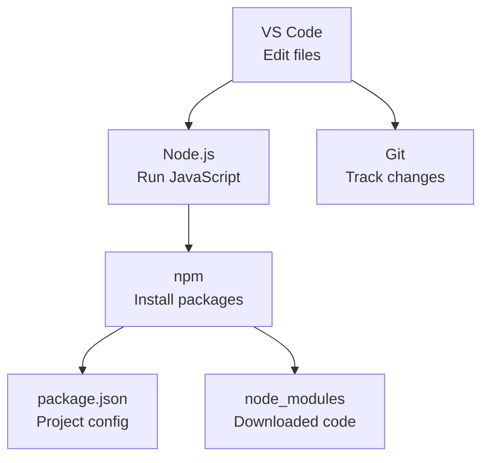

Module 1: Introduction to Full Stack Development | Lesson 4 of 5 | 20 minutes | Prerequisites: [Lesson 3](03-client-server-request-response.md)

## Big idea

A developer needs the right tools before building apps. VS Code, Node.js, npm, and Git are the basic tools for frontend and backend work.

## Concepts

VS Code is a code editor. It helps you write, open, and organise files. The integrated terminal lets you run commands without leaving the editor.

Node.js is a runtime that lets JavaScript run outside the browser. This means you can write server-side code in JavaScript.

npm stands for Node Package Manager. It installs and manages packages, which are reusable code libraries.

A package.json file stores project metadata and scripts. It is the main file in a Node project. A package-lock.json file records the exact package versions that were installed, so the project is reproducible. node_modules is the folder where installed packages live. Developers usually do not commit it to Git because it can be large and can be reproduced with `npm install`.

Git is a version control system. It tracks changes in your project so you can save progress, review history, and collaborate.

Real-world analogy: think of a workshop. VS Code is your workbench, Node.js is the machine that runs the work, npm is the supply store, and Git is the project notebook that records each change.

## Diagram



## Code

```bash
# 1. Check that the tools are installed.
node -v
npm -v
git --version

# 2. Create a project file.
npm init -y

# 3. Install a package.
npm install express
```

## Try it

- Open VS Code.
- Open the folder that contains your project.
- Open the integrated terminal with `Ctrl + Backtick`.
- Run `node -v` and `npm -v`.
- If those work, your environment is ready.

## Check yourself

1. What is Node.js used for?  
   <details>
   <summary>Answer</summary>
   It runs JavaScript on a server or local machine, outside the browser.
   </details>

2. Why do we use npm?  
   <details>
   <summary>Answer</summary>
   npm installs packages and manages project dependencies.
   </details>

3. Why is `node_modules` not usually committed?  
   <details>
   <summary>Answer</summary>
   It is generated from package metadata and can be recreated with `npm install`.
   </details>

## Common mistakes

- Installing Node but not restarting the terminal.
- Opening only one file instead of the whole project folder in VS Code.
- Committing `node_modules` to Git.
- Forgetting that Git is not a backup system by itself; it is a change tracker.

## Next lesson

[Lesson 5: Project Structure and Git First Steps](05-project-structure-and-git-first-steps.md)

<details>
<summary>Instructor notes</summary>

Talking points:

- Tell students to install tools before they start coding.
- Remind them that Node and npm are different: Node runs JavaScript, npm installs packages.
- Show the `package.json` file and explain that it is the project’s map.

Live demo steps:

1. Open VS Code.
2. Open the integrated terminal.
3. Run `node -v` and `npm -v`.
4. Run `npm init -y`.
5. Open `package.json` and explain the fields.
6. Explain that `node_modules` is generated and should not be checked in.

</details>
