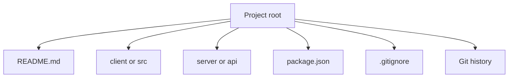

Module 1: Introduction to Full Stack Development | Lesson 5 of 5 | 15 minutes | Prerequisites: [Lesson 4](04-dev-environment.md)

## Big idea

A clean project structure helps you stay organised. Git gives you a reliable way to save work and review progress.

## Concepts

A typical full stack project has separate folders for different concerns. The frontend often lives in a `client` folder or in a root `src` folder. The backend often lives in `server` or `api` folders. A project may also have a root-level README and configuration files.

A `.gitignore` file tells Git which files to ignore. This is important for folders like `node_modules` and for secret files such as `.env`.

Git commands you will use often:

- `git init`: start a new Git repository in the current folder.
- `git status`: see what changed.
- `git add .`: stage all changes.
- `git commit -m "message"`: save a snapshot.
- `git log --oneline`: view recent commits.

Real-world analogy: a clean folder structure is like organising a desk before work. Git is like a history log that records each step, so you can backtrack when something breaks.

## Diagram



## Code

```bash
# 1. Start tracking a project.
git init

# 2. Check what files are changed.
git status

# 3. Save the current snapshot.
git add .
git commit -m "Initial project setup"

# 4. Review the project history.
git log --oneline
```

## Try it

- Create a new folder for a mini project.
- Add a `.gitignore` file with `node_modules/` inside it.
- Run `git init`.
- Create a file, then run `git status`, `git add .`, and `git commit -m "Initial setup"`.

## Check yourself

1. What does `.gitignore` do?  
   <details>
   <summary>Answer</summary>
   It tells Git to ignore files and folders like `node_modules` and secrets.
   </details>

2. Why do we commit?  
   <details>
   <summary>Answer</summary>
   A commit saves a clear snapshot of the project so you can review or restore it later.
   </details>

3. What is the difference between `git add` and `git commit`?  
   <details>
   <summary>Answer</summary>
   `git add` stages changes. `git commit` saves the staged snapshot to history.
   </details>

## Common mistakes

- Forgetting to add a `.gitignore` file.
- Running `git add .` before checking status and making sure you are not adding secrets.
- Creating many changes in one commit without a clear message.

## Next lesson

[Module 1 quiz](../quiz.md)

<details>
<summary>Instructor notes</summary>

Talking points:

- Project structure is a habit, not a rulebook.
- Explain that the exact folder names may change, but the purpose stays the same.
- Tell students to keep the repo clean and only commit what matters.

Live demo steps:

1. In the terminal, run `git init` inside a demo folder.
2. Run `git status`.
3. Add a file and commit it.
4. Explain the difference between untracked, staged, and committed files.
5. Show the commit log.

</details>
