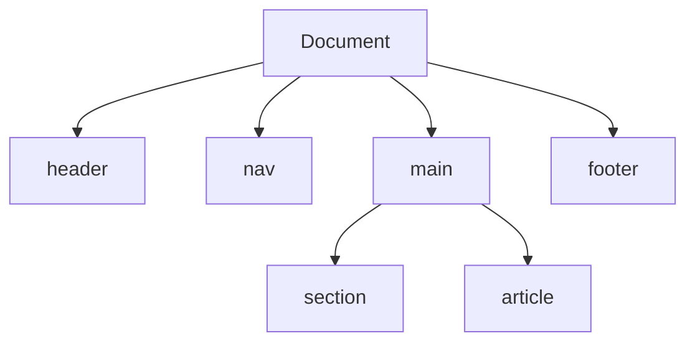

Module 2: HTML, CSS, and JavaScript | Lesson 1 of 10 | 15 minutes | Prerequisites: [Module 1](../../module-01-intro/README.md)

## Big idea

HTML gives a page structure. Semantic elements tell the browser and assistive tech what each part means, which makes pages easier to understand and easier to work with.

A page with clear headings, lists, links, and sections is easier to read for users and search engines. This matters because a task manager page is more than a collection of boxes; it is a structured set of ideas.

## Concepts

A semantic element is an HTML tag with meaning. It describes the role of the content, not just how it looks.

- `header`: the top part of a page or a section. It usually contains a title or navigation.
- `nav`: a group of links used for navigation.
- `main`: the main content of the page. There should usually be one main area.
- `section`: a big topic area inside the page.
- `article`: a self-contained chunk of content, like a blog post or task card.
- `footer`: the bottom section, often with contact info or page links.
- `h1` to `h6`: headings. `h1` is the most important heading.
- `ul` and `ol`: unordered and ordered lists.
- `a`: a link to another page or place.
- `img`: an image.

Real-world analogy: a book has a title page, chapters, and a table of contents. Semantic HTML gives a web page the same structure so readers and machines know where the important parts are.

### Why semantics matter

Semantic HTML improves accessibility and SEO. Accessibility means people using screen readers can understand the page. SEO means search engines can understand what the page is about.

## Diagram



## Code

```html
<!DOCTYPE html>
<html lang="en">
  <head>
    <meta charset="UTF-8" />
    <meta name="viewport" content="width=device-width, initial-scale=1.0" />
    <title>Task Manager</title>
  </head>
  <body>
    <header>
      <nav>
        <a href="#tasks">Tasks</a>
        <a href="#stats">Stats</a>
      </nav>
      <h1>Task Manager</h1>
    </header>

    <main>
      <section id="tasks">
        <h2>My tasks</h2>
        <ul>
          <li>Review project brief</li>
          <li>Write CSS for cards</li>
        </ul>
      </section>

      <article>
        <h3>Today</h3>
        <p>Finish the dashboard layout.</p>
      </article>
    </main>

    <footer>
      <p>Built for learning.</p>
    </footer>
  </body>
</html>
```

## Try it

- Open the page in a browser.
- Find the `header`, `main`, and `footer` sections.
- Change one heading from `h2` to `h3` and notice how the page still works.
- Add an image with `alt` text and explain what it shows in one sentence.

## Check yourself

1. What is a semantic element?  
   <details>
   <summary>Answer</summary>
   A semantic element is a tag that gives meaning to the content, such as `header`, `main`, or `article`.
   </details>

2. Why do headings matter?  
   <details>
   <summary>Answer</summary>
   Headings show the page structure and help users and screen readers understand the main ideas in order.
   </details>

3. What is the difference between `section` and `article`?  
   <details>
   <summary>Answer</summary>
   A `section` groups related content inside a page. An `article` is a self-contained item, like a blog post or task summary.
   </details>

## Common mistakes

- Using `div` for everything instead of choosing a meaningful tag.
- Forgetting that `main` should usually appear once on the page.
- Using a heading level out of order, such as jumping from `h1` to `h4`.

## Next lesson

[Lesson 2: HTML forms, tables, and media](02-html-forms-tables-media.md)

<details>
<summary>Instructor notes</summary>

Talking points:

- Use a real page, like a landing page or article page, to show semantic structure.
- Explain that semantics help both humans and machines, not just the browser.
- Show how screen readers announce headings and landmarks.

Live demo steps:

1. Open a page with no semantic tags.
2. Add `header`, `nav`, `main`, and `footer`.
3. Explain how the structure helps the browser understand the page.
4. Show a page with a list and a heading hierarchy.

Best pre-reading:

- Lesson 2 on forms and tables is a good follow-up.

</details>
