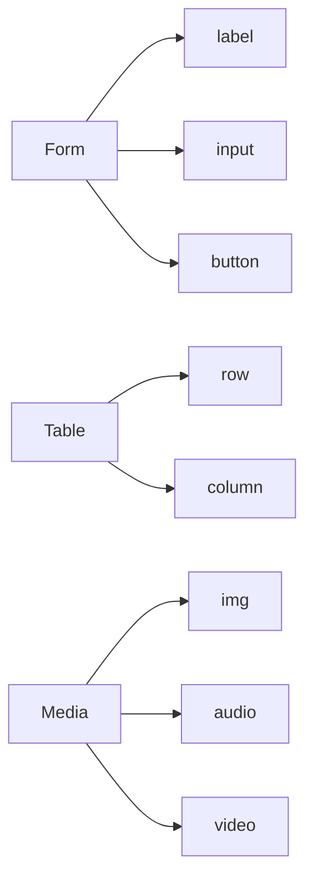

Module 2: HTML, CSS, and JavaScript | Lesson 2 of 10 | 20 minutes | Prerequisites: [Lesson 1](01-html-semantic-elements.md)

## Big idea

Forms collect user input. Tables organize data in rows and columns. Media elements add images, audio, and video to a page.

These elements are the building blocks of a task manager: a form lets users add tasks, a table shows the task list, and media helps make the interface richer.

## Concepts

A form is a container for user input. Each field usually has a label so the user knows what to type.

- `input`: a field where users type or choose values.
- `label`: a text label tied to a form control.
- `button`: a clickable action, such as Save or Submit.
- `required`: a validation attribute that tells the browser the field must be filled.
- `type="email"`: the browser can validate an email format.
- `table`: a way to display rows and columns of data.
- `img`: an image with `alt` text for accessibility.
- `audio` and `video`: media elements for sound and video.

Real-world analogy: a task form is like a paper form at a school office. The label tells you what goes in each box, and the required rule prevents missing information.

### Common input types

- `text`: short free text
- `email`: email address
- `number`: numeric values
- `date`: date selection
- `checkbox`: yes/no option
- `radio`: choose one option from many

## Diagram



## Code

```html
<form>
  <label for="task-name">Task name</label>
  <input id="task-name" name="task-name" type="text" required />

  <label for="due-date">Due date</label>
  <input id="due-date" name="due-date" type="date" />

  <label for="priority">Priority</label>
  <select id="priority" name="priority">
    <option value="low">Low</option>
    <option value="medium">Medium</option>
    <option value="high">High</option>
  </select>

  <button type="submit">Add task</button>
</form>

<table>
  <thead>
    <tr>
      <th>Task</th>
      <th>Due</th>
      <th>Status</th>
    </tr>
  </thead>
  <tbody>
    <tr>
      <td>Write CSS</td>
      <td>2026-11-07</td>
      <td>Pending</td>
    </tr>
  </tbody>
</table>


```

## Try it

- Create a small form with `label`, `input`, and `button`.
- Add `required` to one field and submit the form without filling it.
- Open the browser and see the browser validation message.
- Add a table with two rows and one image.

## Check yourself

1. What is the purpose of a `label`?  
   <details>
   <summary>Answer</summary>
   A `label` tells the user what a form field is for and improves accessibility.
   </details>

2. Why do we use `required`?  
   <details>
   <summary>Answer</summary>
   It tells the browser that a field must be filled before the form is submitted.
   </details>

3. When is a table useful?  
   <details>
   <summary>Answer</summary>
   A table is useful when you want to show rows and columns of related data, like tasks and their due dates.
   </details>

## Common mistakes

- Forgetting to connect a `label` to its `input` with `for` and `id`.
- Using a table for page layout instead of actual tabular data.
- Missing `alt` text on images.

## Next lesson

[Lesson 3: CSS selectors and the box model](03-css-selectors-and-box-model.md)

<details>
<summary>Instructor notes</summary>

Talking points:

- Show how forms are everywhere: signup, login, search, and task creation.
- Explain that `required` is a first layer of validation, not a full security system.
- Show the difference between data tables and visual layout tables.

Live demo steps:

1. Create a tiny task form.
2. Add `required` and explain browser validation.
3. Add a table showing tasks.
4. Show how image `alt` text is read by screen readers.

Best pre-reading:

- Lesson 3 is ideal next because CSS will style the form and table.

</details>
