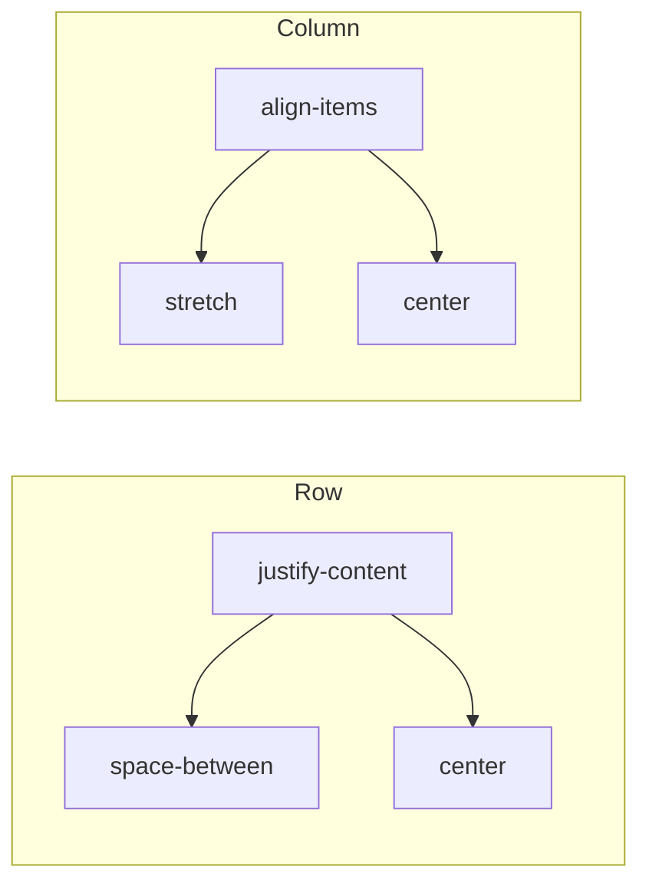

Module 2: HTML, CSS, and JavaScript | Lesson 4 of 10 | 20 minutes | Prerequisites: [Lesson 3](03-css-selectors-and-box-model.md)

## Big idea

Flexbox is a layout system for arranging items in one row or one column. It is great for navbars, card rows, and centered content.

Many beginner layouts are easier with Flexbox because it handles space, alignment, and wrapping without fragile manual margins.

## Concepts

The flex container is the parent element. Its children become flex items.

- `display: flex`: turns a container into a flex layout.
- `flex-direction`: sets the main axis direction: row or column.
- `justify-content`: aligns items along the main axis.
- `align-items`: aligns items along the cross axis.
- `gap`: adds space between items.
- `flex-wrap`: allows items to wrap to a new line.

Main axis is the direction flex items flow. Cross axis is the opposite direction.

Real-world analogy: a row of books on a shelf is like a flex row. You choose how they line up, how much spacing there is, and whether they stay in one row or wrap to the next.

## Diagram



## Code

```css
.navbar {
  display: flex;
  justify-content: space-between;
  align-items: center;
  gap: 16px;
  padding: 16px;
}

.card-row {
  display: flex;
  flex-wrap: wrap;
  gap: 20px;
}

.card {
  flex: 1 1 220px;
}
```

## Try it

- Create a `.navbar` with three links.
- Use `justify-content: space-between` and then `center`.
- Add a row of cards and set `flex-wrap: wrap`.
- Change `gap` and notice how the spacing changes.

## Check yourself

1. What is the main axis in Flexbox?  
   <details>
   <summary>Answer</summary>
   The main axis is the direction flex items flow, usually left to right for row layouts or top to bottom for column layouts.
   </details>

2. What does `justify-content` do?  
   <details>
   <summary>Answer</summary>
   It aligns items along the main axis, such as center, space-between, or flex-start.
   </details>

3. When do we use `flex-wrap`?  
   <details>
   <summary>Answer</summary>
   We use it when items should move to a new line when there is not enough space.
   </details>

## Common mistakes

- Using `margin` for spacing instead of `gap` when a flex container is meant to control alignment.
- Forgetting that `justify-content` and `align-items` work on different axes.
- Setting `flex-direction` without thinking about the main axis.

## Next lesson

[Lesson 5: CSS Grid](05-css-grid.md)

<details>
<summary>Instructor notes</summary>

Talking points:

- Compare a row of cards with a layout that needs exact columns.
- Explain that Flexbox is one-dimensional; Grid is two-dimensional.
- Show a navbar and a card row in the same page.

Live demo steps:

1. Create a flex navbar.
2. Create a flex row of task cards.
3. Change `justify-content` and `align-items` in DevTools.
4. Explain the difference between main axis and cross axis.

Best pre-reading:

- Lesson 5 on Grid is the natural next step.

</details>
