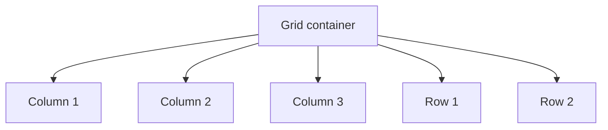

Module 2: HTML, CSS, and JavaScript | Lesson 5 of 10 | 20 minutes | Prerequisites: [Lesson 4](04-flexbox.md)

## Big idea

CSS Grid is a two-dimensional layout system. It arranges items in rows and columns, which makes dashboards and complex page layouts much easier.

Use Grid when you want precise control over both columns and rows. Use Flexbox when you want one-dimensional alignment in a row or column.

## Concepts

A grid container holds grid items. The main properties are:

- `display: grid`: creates a grid container.
- `grid-template-columns`: sets the column widths.
- `grid-template-rows`: sets the row heights.
- `gap`: adds spacing between cells.
- `grid-template-areas`: names sections of the layout.

A decision table helps choose the right tool:

| Need | Better choice |
|---|---|
| One row of items | Flexbox |
| One column layout | Flexbox |
| Dashboard with rows and columns | Grid |
| Complex page structure with named areas | Grid |

Real-world analogy: a grid is like a spreadsheet. You decide how many columns each row has and where each cell lives.

## Diagram



## Code

```css
.dashboard {
  display: grid;
  grid-template-columns: 220px 1fr 220px;
  grid-template-rows: auto 1fr;
  gap: 16px;
  min-height: 500px;
}

.sidebar { grid-column: 1; }
.main-panel { grid-column: 2 / 4; }
```

## Try it

- Create a dashboard with three columns.
- Add a sidebar, main content, and right panel.
- Change `grid-template-columns` from `1fr 1fr` to `200px 1fr`.
- Compare the layout with the same items in a Flexbox row.

## Check yourself

1. What is CSS Grid best for?  
   <details>
   <summary>Answer</summary>
   Grid is best for two-dimensional layouts with rows and columns, such as dashboards or card layouts.
   </details>

2. What is the difference between Grid and Flexbox?  
   <details>
   <summary>Answer</summary>
   Flexbox is one-dimensional and good for rows or columns. Grid is two-dimensional and handles both at the same time.
   </details>

3. What does `gap` do?  
   <details>
   <summary>Answer</summary>
   It adds spacing between grid cells.
   </details>

## Common mistakes

- Choosing the wrong layout tool for the job.
- Forgetting that Grid controls the whole layout, not only a single item.
- Hard-coding pixel widths without thinking about smaller screens.

## Next lesson

[Lesson 6: Responsive design](06-responsive-design.md)

<details>
<summary>Instructor notes</summary>

Talking points:

- Use a dashboard example to show where Grid makes sense.
- Ask students to explain when Flexbox is enough and when Grid is needed.
- Show that Grid is usually a better fit for app shells than simple alignment.

Live demo steps:

1. Build a simple dashboard with three sections.
2. Set the grid columns.
3. Resize the browser and show the layout stays arranged.
4. Compare it with a Flexbox-only version.

Best pre-reading:

- Lesson 6 on responsive design is next because mobile layouts often depend on Grid and Flexbox together.

</details>
