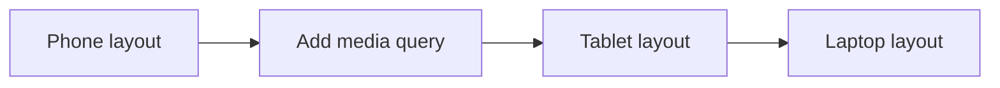

Module 2: HTML, CSS, and JavaScript | Lesson 6 of 10 | 20 minutes | Prerequisites: [Lesson 5](05-css-grid.md)

## Big idea

Responsive design lets a page adapt to different screen sizes. A layout that works on a phone should also work on a tablet and a laptop.

A mobile-first approach means you design for small screens first, then add more layout rules as the screen gets wider.

## Concepts

A media query is a CSS rule that applies only when a screen meets a condition like a minimum width.

```css
@media (min-width: 700px) {
  .cards {
    grid-template-columns: repeat(2, 1fr);
  }
}
```

- viewport: the visible area of the browser window
- `meta viewport` tag: tells the browser how to scale content on mobile devices
- relative units: `em`, `rem`, `%`, `vw`, `vh` instead of only fixed pixels

Real-world analogy: a table layout can be used at a dining room table, but the same table needs different spacing and comfort when it is in a small studio apartment. Responsive design adapts the furniture to the room.

## Diagram



## Code

```html
<meta name="viewport" content="width=device-width, initial-scale=1.0" />
```

```css
.card-grid {
  display: grid;
  grid-template-columns: 1fr;
  gap: 16px;
}

@media (min-width: 700px) {
  .card-grid {
    grid-template-columns: repeat(2, 1fr);
  }
}
```

## Try it

- Open a page in browser DevTools and switch to mobile device mode.
- Resize the window and watch the grid switch from one column to two.
- Add a `meta viewport` tag if the page scales poorly on mobile.

## Check yourself

1. What is a media query?  
   <details>
   <summary>Answer</summary>
   A media query is a CSS condition that applies styles only when a browser matches a certain width or device feature.
   </details>

2. What does the viewport meta tag do?  
   <details>
   <summary>Answer</summary>
   It tells the browser to use the device width as the page width and to scale content correctly on mobile screens.
   </details>

3. Why is mobile-first design useful?  
   <details>
   <summary>Answer</summary>
   It helps you design the simplest version first, then add more features and layout complexity as screen size grows.
   </details>

## Common mistakes

- Designing for desktop first and shrinking later.
- Forgetting the viewport meta tag on mobile pages.
- Using fixed widths on small screens and expecting everything to fit.

## Next lesson

[Lesson 7: JavaScript core](07-javascript-core.md)

<details>
<summary>Instructor notes</summary>

Talking points:

- Use the same task cards across phone and desktop to show the power of responsive design.
- Explain that a responsive page is not just smaller text; it is a different layout strategy.
- Show how `meta viewport` fixes a common mobile bug.

Live demo steps:

1. Open the page in a desktop browser.
2. Toggle device mode and inspect the layout.
3. Add `@media` rules and show the change.
4. Explain that layout rules are triggered by width.

Best pre-reading:

- Lesson 7 introduces JavaScript, which will make the page interactive.

</details>
