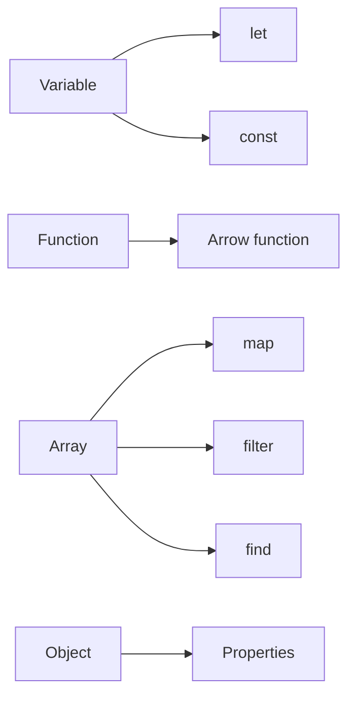

Module 2: HTML, CSS, and JavaScript | Lesson 7 of 10 | 25 minutes | Prerequisites: [Lesson 6](06-responsive-design.md)

## Big idea

JavaScript adds behavior to a page. It stores values, repeats work, and reacts to user actions such as clicking a button or typing in a form.

A task manager is a good example. The page starts with static HTML, but JavaScript can turn that into an interactive app that adds, deletes, and marks tasks complete.

## Concepts

A variable stores a value so the code can use it later.

- `let`: a variable that can change after it is created.
- `const`: a variable that should not be reassigned.

A data type is the kind of value a variable stores.

- string: text, like `'task name'`
- number: numeric value, like `3` or `12.5`
- boolean: true or false
- array: a list of values
- object: a collection of named values

A function is a reusable block of code. Arrow functions are a shorter syntax.

```js
const addTask = (title) => {
  return `Task: ${title}`;
};
```

Arrays have helpful methods:

- `map()`: create a new array from each item
- `filter()`: keep only some items
- `find()`: get the first matching item

Objects hold related data:

```js
const task = {
  title: 'Write CSS',
  done: false,
  priority: 'high'
};
```

Destructuring lets you pull values from arrays or objects quickly.

```js
const { title, done } = task;
```

Template literals use backticks and let you combine variables into strings more cleanly.

```js
console.log(`Task: ${title}`);
```

Real-world analogy: variables are like labeled boxes. A function is a recipe you can repeat. An array is a to-do list. An object is a task card with several fields in one package.

## Diagram



## Code

```js
const tasks = [
  { id: 1, title: 'Write HTML', done: true },
  { id: 2, title: 'Style card', done: false },
  { id: 3, title: 'Add JS', done: false }
];

const pendingTasks = tasks.filter((task) => !task.done);
const firstTask = tasks.find((task) => task.id === 2);

console.log('Pending tasks:', pendingTasks);
console.log('First matching task:', firstTask);
```

## Try it

- Open a browser console or run the script in Node.
- Create an array of three task objects.
- Use `map()` to add a `doneLabel` property for each task.
- Experiment with `filter()` to show only incomplete tasks.

## Check yourself

1. What is the difference between `let` and `const`?  
   <details>
   <summary>Answer</summary>
   `let` can be reassigned. `const` should stay the same after it is created.
   </details>

2. What does `filter()` do?  
   <details>
   <summary>Answer</summary>
   `filter()` creates a new array with only the items that pass a condition.
   </details>

3. What is destructuring?  
   <details>
   <summary>Answer</summary>
   Destructuring is a shortcut for pulling values out of an array or object into separate variables.
   </details>

## Common mistakes

- Reassigning `const` values by accident.
- Using `==` instead of `===` when comparing values.
- Forgetting that `filter()`, `map()`, and `find()` return new values and do not change the original array.

## Next lesson

[Lesson 8: DOM and events](08-dom-and-events.md)

<details>
<summary>Instructor notes</summary>

Talking points:

- Show a tiny array in the browser and explain how JavaScript transforms it into UI.
- Explain that functions can be reused; this is a core idea in web apps.
- Show `map()` and `filter()` using real task data.

Live demo steps:

1. Open the browser console.
2. Create a short array of tasks.
3. Run `filter()` and `map()`.
4. Explain how each method returns a new array.

Best pre-reading:

- Lesson 8 is the next step because it uses JavaScript to manipulate the DOM.

</details>
