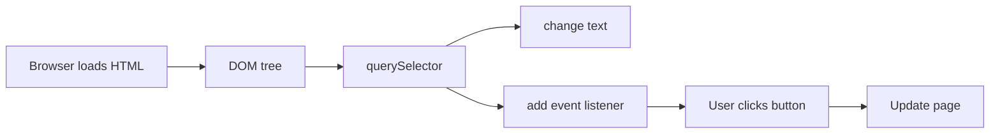

Module 2: HTML, CSS, and JavaScript | Lesson 8 of 10 | 20 minutes | Prerequisites: [Lesson 7](07-javascript-core.md)

## Big idea

The DOM is the browser's representation of the HTML page. JavaScript uses the DOM to read, change, create, and remove elements.

Events let the page react to user actions such as clicks, typing, and submissions. This turns a static HTML page into a real app.

## Concepts

The Document Object Model, or DOM, is the object structure that JavaScript sees when a browser loads a page.

- `document.querySelector()` finds the first matching element.
- `document.querySelectorAll()` finds all matching elements.
- `textContent` changes visible text.
- `classList.add()` adds a CSS class.
- `createElement()` creates a new element.
- `appendChild()` adds a new element to the page.
- `addEventListener()` listens for a browser event such as a click.

Event delegation is a pattern where a parent element listens for events from its children. It is useful for lists of tasks.

Real-world analogy: the DOM is like the backstage crew list for a theater show. JavaScript can grab the right actor, change the script, or add a new performer to the cast.

## Diagram



## Code

```js
const form = document.querySelector('#task-form');
const list = document.querySelector('#task-list');

form.addEventListener('submit', (event) => {
  event.preventDefault();

  const input = document.querySelector('#task-input');
  const item = document.createElement('li');
  item.textContent = input.value.trim();

  if (item.textContent) {
    list.appendChild(item);
    input.value = '';
  }
});
```

## Try it

- Create an HTML list and a form.
- Add a submit event listener.
- When the user enters text and clicks submit, add a new list item.
- Add a button that removes the last item when clicked.

## Check yourself

1. What is the DOM?  
   <details>
   <summary>Answer</summary>
   The DOM is the browser's structured representation of the web page, which JavaScript can update.
   </details>

2. What does `addEventListener()` do?  
   <details>
   <summary>Answer</summary>
   It waits for a browser event, such as a click or a form submit, and runs a function when that event occurs.
   </details>

3. Why is event delegation useful?  
   <details>
   <summary>Answer</summary>
   It lets one parent element handle events for many child items, which is helpful for dynamic task lists.
   </details>

## Common mistakes

- Forgetting to call `preventDefault()` on a form submit.
- Trying to select elements before the browser has loaded the page.
- Appending items without checking whether the input has a value.

## Next lesson

[Lesson 9: Fetch and async/await](09-fetch-and-async-await.md)

<details>
<summary>Instructor notes</summary>

Talking points:

- Explain that DOM changes are not magic; they are just JavaScript objects updating the page.
- Show a simple button click and the function that runs after the click.
- Use a small to-do list as the running example.

Live demo steps:

1. Write a `<button>` and a `<ul>`.
2. Select them with JavaScript.
3. Add a click handler that adds a list item.
4. Explain the flow from click to DOM update.

Best pre-reading:

- Lesson 9 introduces async actions and data loading, which builds on event-driven code.

</details>
