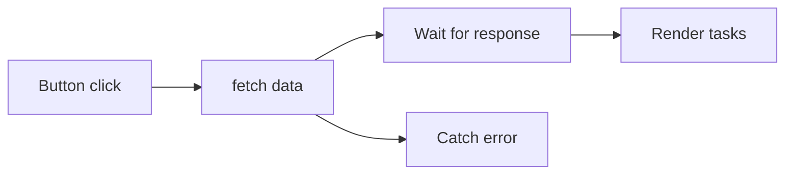

Module 2: HTML, CSS, and JavaScript | Lesson 9 of 10 | 20 minutes | Prerequisites: [Lesson 8](08-dom-and-events.md)

## Big idea

JavaScript can do work in the background. This is important when a page fetches data from a server or waits for a slow response.

A synchronous program runs one step at a time. An asynchronous program can keep the page responsive while waiting for data. `fetch()` and `async/await` make this easier to read.

## Concepts

Synchronous means tasks happen one after another in order. Asynchronous means some tasks can wait without blocking the rest of the app.

A promise is an object that represents a future result. It can succeed or fail.

- `fetch()` starts an HTTP request to a URL.
- `await` pauses a function until the promise resolves.
- `try/catch` handles errors safely.
- JSON stands for JavaScript Object Notation. It is a common data format.

```js
const response = await fetch('https://jsonplaceholder.typicode.com/todos?_limit=3');
const data = await response.json();
```

Real-world analogy: a restaurant can take your order and then continue serving other customers while the kitchen prepares your food. A synchronous app would wait at the counter and do nothing else.

## Diagram



## Code

```js
async function loadTasks() {
  try {
    const response = await fetch('https://jsonplaceholder.typicode.com/todos?_limit=3');

    if (!response.ok) {
      throw new Error('Request failed');
    }

    const data = await response.json();
    console.log('Tasks loaded:', data);
  } catch (error) {
    console.error('Something went wrong:', error.message);
  }
}

loadTasks();
```

## Try it

- Run a `fetch()` call in the browser console.
- Log the response and the parsed JSON.
- Add a loading message before the request and an error message if the request fails.

## Check yourself

1. What is the difference between synchronous and asynchronous code?  
   <details>
   <summary>Answer</summary>
   Synchronous code runs step by step and blocks other work. Asynchronous code can wait while the app continues running.
   </details>

2. What is a promise?  
   <details>
   <summary>Answer</summary>
   A promise is a JavaScript object that represents a value that will exist in the future, either successfully or with an error.
   </details>

3. Why do we use `try/catch`?  
   <details>
   <summary>Answer</summary>
   It lets us respond to errors in a controlled way instead of crashing the app.
   </details>

## Common mistakes

- Forgetting to handle the network error case.
- Forgetting to call `response.json()` after a fetch request.
- Writing code that waits forever because the request never resolves.

## Next lesson

[Lesson 10: ES6 modules and reverse proxy](10-es6-modules-and-reverse-proxy.md)

<details>
<summary>Instructor notes</summary>

Talking points:

- Use a loading spinner and error message from the example to show how async code affects UI.
- Explain that `await` reads more like plain English than nested callbacks.
- Clarify that `fetch()` is still a network request and may fail.

Live demo steps:

1. Create a button that loads tasks.
2. Show loading text before the request.
3. Simulate a network failure and show the error state.
4. Render the list of returned tasks.

Best pre-reading:

- Lesson 10 introduces modules and proxying, which are common in real apps.

</details>
