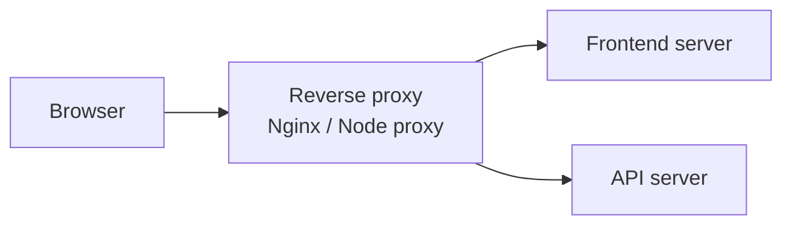

Module 2: HTML, CSS, and JavaScript | Lesson 10 of 10 | 20 minutes | Prerequisites: [Lesson 9](09-fetch-and-async-await.md)

## Big idea

JavaScript modules let you split code into smaller files. This makes code easier to organise, test, and reuse.

A reverse proxy is a server that sits in front of other servers and forwards requests to the right place. It is often used to hide app details, balance traffic, and simplify deployment.

## Concepts

A module is an isolated file with its own scope. You can export values from one file and import them into another.

- `export`: makes a value available to other files
- `import`: brings a value into a file
- `type="module"`: tells the browser to treat a script as a module

Example:

```js
// api.js
export async function fetchTasks() {
  const response = await fetch('https://jsonplaceholder.typicode.com/todos?_limit=3');
  return response.json();
}
```

```js
// main.js
import { fetchTasks } from './api.js';

const tasks = await fetchTasks();
console.log(tasks);
```

A reverse proxy listens on one port and forwards requests to other servers. It is often used in production to route `/api` traffic to a backend while sending other requests to a frontend server.

Real-world analogy: a reverse proxy is like a receptionist at a hotel. Guests ask for one desk, and the receptionist sends them to the correct room or office.

## Diagram



## Code

```html
<script type="module" src="./main.js"></script>
```

```js
// api.js
export const API_URL = 'https://jsonplaceholder.typicode.com/todos?_limit=5';
```

```js
// main.js
import { API_URL } from './api.js';

console.log(API_URL);
```

## Try it

- Create two JavaScript files and import from one to the other.
- Add `type="module"` to the script tag in an HTML file.
- Read the browser console and confirm the imported value appears.
- Draw a simple request flow from browser to proxy to backend.

## Check yourself

1. Why use modules?  
   <details>
   <summary>Answer</summary>
   Modules keep code separated by responsibility, which reduces confusion and makes large apps easier to maintain.
   </details>

2. What is a reverse proxy?  
   <details>
   <summary>Answer</summary>
   It is a server that receives requests and forwards them to the correct app or service behind it.
   </details>

3. Why is `type="module"` needed?  
   <details>
   <summary>Answer</summary>
   The browser needs to know that the script uses JavaScript module syntax such as `import` and `export`.
   </details>

## Common mistakes

- Forgetting `type="module"` when using import/export in the browser.
- Mixing unrelated logic in one file.
- Treating a proxy as a database or a web app; it is only a traffic manager.

## Next lesson

[Module 2 quiz](../quiz.md)

<details>
<summary>Instructor notes</summary>

Talking points:

- Show the app layer pattern: browser imports a module, module fetches data, and proxy routes requests in production.
- Explain that a reverse proxy is often invisible to the user but essential in real deployment setups.
- Connect it to the capstone by saying the frontend will eventually talk to a backend server.

Live demo steps:

1. Explain the module split with `api.js` and `main.js`.
2. Show how the browser loads the module.
3. Draw the proxy flow on a whiteboard.
4. Tie it to the end-of-module capstone work.

Best pre-reading:

- The final quiz is the best review after this lesson.

</details>
